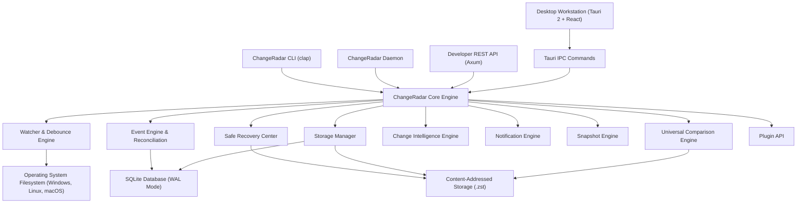
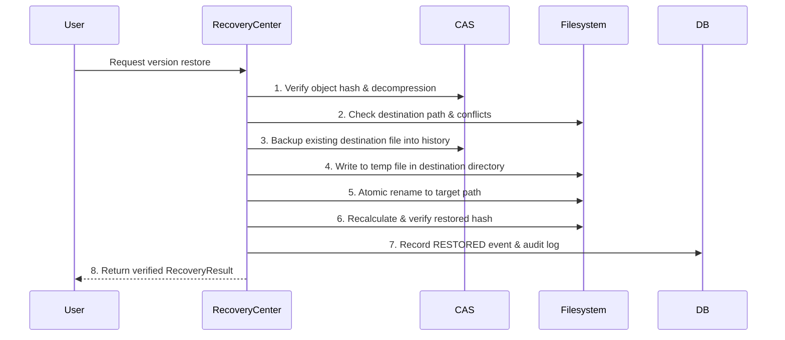

# ChangeRadar — System Architecture & Engineering Specification

## 1. High-Level Architecture Overview

ChangeRadar is a local-first, modular file intelligence, version history, and recovery workstation built in Rust and React/TypeScript.



---

## 2. Core Modular Crates

| Crate | Responsibilities |
| :--- | :--- |
| `crates/types` | Domain models, `ChangeKind`, `FileEvent`, `FileVersion`, `Snapshot`, serialization. |
| `crates/hashing` | BLAKE3 streaming hasher, chunked hashing (64KB), perceptual image dHash. |
| `crates/database` | SQLite database with WAL mode, schema migrations, and repository queries for all 17 tables. |
| `crates/version_store` | Content-Addressed Storage (CAS) with Zstandard compression, deduplication, reference counting, and integrity verification. |
| `crates/watcher` | Recursive directory watcher with `notify`, event debouncing, coalescing, and glob-based ignore engine. |
| `crates/event_engine` | Event classifier (`CREATED`, `MODIFIED`, `DELETED`, `RENAMED`, `RESTORED`), periodic reconciliation scanner. |
| `crates/comparison` | Universal comparison: Myers text diff, structural JSON tree diff, CSV record diff, image visual diff, and binary fallback. |
| `crates/recovery` | 8-step safety pipeline for reversible restorations with pre-flight checks and atomic replaces. |
| `crates/intelligence` | Transparent Radar Score calculation, activity statistics, and anomaly detection heuristics. |
| `crates/notification_engine` | Rule-based event filtering and priority in-app alert dispatches. |
| `crates/snapshot_engine` | Point-in-time directory state capture, snapshot comparison, and snapshot restore. |
| `crates/storage_manager` | Retention policy evaluation, storage cleanup preview, and safe garbage collection. |
| `crates/search` | Unified global search across files, events, folders, and notes. |
| `crates/plugin_api` | Sandboxed plugin manifests, declared capabilities, and change hook invocations. |
| `crates/configuration` | Operating-system path resolution and user preference persistence. |
| `crates/platform` | Cross-platform shell integration (`explorer`, `xdg-open`, `open`) and platform detection. |
| `crates/local_api` | Embedded Axum HTTP server on `127.0.0.1:41820` with Bearer token authentication. |
| `crates/core` | Unified `ChangeRadarEngine` facade orchestrating all subsystems. |

---

## 3. Content-Addressed Storage (CAS) Engine

ChangeRadar stores historical content objects by their **BLAKE3** cryptographic hash:

```text
objects/
├── ab/
│   └── cd/
│       └── abcd1234ef56...zst
```

### Key Properties:
- **Automatic Deduplication:** If two files (or two revisions of the same file) contain identical content, only one physical `.zst` object is stored on disk, bumping the reference count in SQLite.
- **High Performance Compression:** Uses Zstandard (level 3) for fast compression and near-instant decompression.
- **Integrity Verification:** Every stored and restored object is verified against its BLAKE3 hash to detect bit rot or corruption.
- **Safe Garbage Collection:** Objects are purged only when their reference count drops to 0, and pinned versions are permanently protected.

---

## 4. 8-Step Safe Recovery Pipeline

Recovery in ChangeRadar prioritizes data preservation above all else:



---

## 5. Desktop Workstation & CLI Integration

Both the desktop application (`apps/desktop` Tauri 2 + React) and the CLI (`apps/cli` `changeradar`) share the identical underlying engine, SQLite database, and CAS storage directory.
The Background Daemon (`apps/daemon` `changeradard`) can run headless as a background service while the desktop GUI is closed, maintaining continuous filesystem monitoring.
