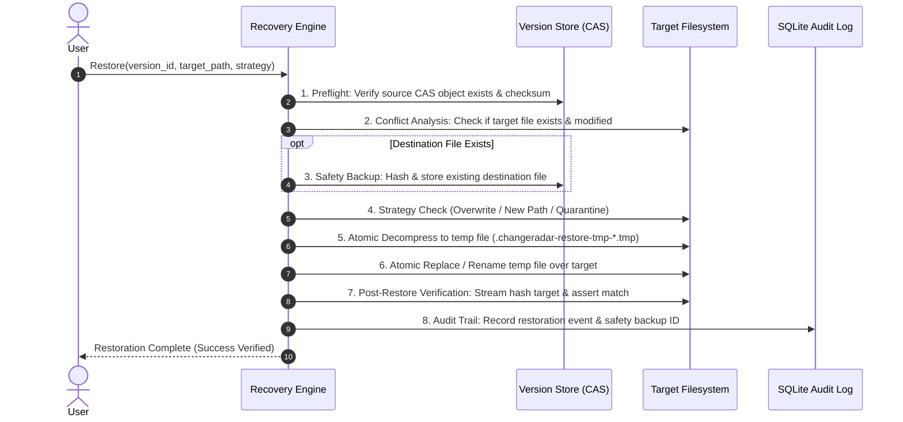

# ChangeRadar

> **"See every important change. Understand every difference. Recover with confidence."**

[](LICENSE)
[](https://www.rust-lang.org/)
[](https://tauri.app/)
[](https://react.dev/)
[](https://www.sqlite.org/)
[](PRIVACY.md)
[]()

ChangeRadar is a universal, local-first file intelligence, version history, and recovery platform for everyday computer users, researchers, writers, office professionals, and software engineers. It continuously watches designated filesystem directories, deduplicates and indexes changes in a Zstandard-compressed Content-Addressed Store (CAS), computes transparent change intelligence with a Radar Score (0–100), visualizes differences across multiple formats (text, JSON, CSV, images, PDFs, binary), and provides an 8-step safety-first file recovery pipeline.

ChangeRadar is completely offline-first, free forever, open source, and collects zero telemetry.

---

## Table of Contents

- [Core Principles](#core-principles)
- [System Architecture](#system-architecture)
- [Key Features](#key-features)
- [System Components](#system-components)
- [Quick Start](#quick-start)
  - [Prerequisites](#prerequisites)
  - [Building from Source](#building-from-source)
  - [Using the Command Line (`changeradar`)](#using-the-command-line-changeradar)
  - [Running the Background Daemon (`changeradard`)](#running-the-background-daemon-changeradard)
  - [Running the Desktop Application](#running-the-desktop-application)
- [Architecture & Storage](#architecture--storage)
- [Comparison Engine Matrix](#comparison-engine-matrix)
- [Safe 8-Step Recovery Pipeline](#safe-8-step-recovery-pipeline)
- [Developer REST API](#developer-rest-api)
- [Plugin System](#plugin-system)
- [Documentation Index](#documentation-index)
- [Contributing & License](#contributing--license)

---

## Core Principles

1. **Free Forever & Open Source**: MIT licensed without paywalled features or artificial limits.
2. **Local-First & Offline-First**: All data, historical versions, metadata, and comparisons stay 100% on your local machine. No account, no subscription, no mandatory cloud dependency.
3. **Zero Telemetry**: No tracking, phone-home beacons, crash analytics, or external network requests.
4. **Safety & Reversibility First**: Recovery operations never blindly overwrite files without pre-flight conflict checks, automatic safety backups, and atomic filesystem transactions.
5. **Universal Comprehension**: Diffing engines support plain text, code, nested JSON trees, tabular CSV sheets, perceptual visual image diffing, PDF text streams, and raw binary hex dumps.
6. **Transparent Resource Efficiency**: Streaming BLAKE3 hashing in bounded 64 KB buffers, Zstandard compression level 3, SQLite WAL mode, and debounced filesystem events.

---

## System Architecture

```mermaid
flowchart TD
    subgraph UI ["User Interfaces"]
        Desktop["ChangeRadar Desktop (Tauri 2 + React + TS)"]
        CLI["ChangeRadar CLI (clap)"]
        Daemon["ChangeRadar Daemon (changeradard)"]
    end

    subgraph Core ["ChangeRadar Core Engine"]
        Engine["ChangeRadarEngine Facade"]
        Watcher["Filesystem Watcher (notify + debouncer)"]
        EventEngine["Event Engine (Coalescing & Reconciliation)"]
        Hasher["BLAKE3 Streaming & Perceptual Hasher"]
        DiffEngine["Universal Comparison Engine"]
        RecoveryEngine["8-Step Safe Recovery Engine"]
        IntelEngine["Intelligence & Radar Score Engine"]
        SnapEngine["Directory Snapshot Engine"]
        NotifEngine["Priority Notification Engine"]
        SearchEngine["Unified Global Search Engine"]
        PluginRuntime["Sandboxed Plugin API Runtime"]
        RestAPI["Axum Local REST API (:41820)"]
    end

    subgraph Storage ["Local Storage Subsystems"]
        SQLite[("SQLite 3 (WAL Mode)\n17 Relational Tables")]
        CAS[("Content-Addressed Store\nobjects/ab/cd/<hash>.zst")]
        Config[("config.json\n%LOCALAPPDATA%/ChangeRadar")]
    end

    Desktop -->|IPC Commands| Engine
    CLI -->|Rust API Calls| Engine
    Daemon -->|Background Loop & REST Server| Engine
    Engine --> RestAPI
    Engine --> Watcher
    Engine --> EventEngine
    Engine --> Hasher
    Engine --> DiffEngine
    Engine --> RecoveryEngine
    Engine --> IntelEngine
    Engine --> SnapEngine
    Engine --> NotifEngine
    Engine --> SearchEngine
    Engine --> PluginRuntime
    Engine --> SQLite
    Engine --> CAS
    Engine --> Config
```



---

## Key Features

### 1. Robust Real-Time Filesystem Monitoring
- Recursive directory monitoring using cross-platform OS notifications (`ReadDirectoryChangesW`, `inotify`, `FSEvents`).
- Dynamic ignore engine supporting git-style glob rules, hidden files, build artifacts (`node_modules`, `target`), and temporary office lock files.
- Event coalescing and debouncing to properly classify atomic file writes (save-via-temp-and-rename).
- Periodic background reconciliation scanner to recover missed events and handle drive reconnections.

### 2. High-Performance Content-Addressed Storage (CAS)
- Streaming BLAKE3 256-bit hashing in 64 KB buffers—never loads multi-gigabyte files into RAM.
- Two-tier sharded directory structure: `objects/ab/cd/<blake3_hash>.zst`.
- Zstandard compression (level 3) with content-level deduplication across folders and versions.
- Atomic write verification: every object is compressed to an isolated temporary file, verified, and renamed atomically into place.
- Reference counting, manual pin protection, retention policies, and garbage collection.

### 3. Multi-Format Universal Comparison Engine
- **Text & Code**: Myers LCS line-by-line diff, unified patch output, and side-by-side aligned diffs with character-level highlights.
- **Structural JSON**: Deep recursive structural diff comparing objects, arrays, and primitives with RFC 6901 / JSONPath markers (e.g., `$.users[2].email`).
- **Tabular CSV**: Header-aware row and cell comparisons with primary-key tracking.
- **Images**: Dimension comparison, exact byte matching, and 64-bit perceptual difference hashing (`dHash`) with visual similarity scoring (0–100%).
- **PDF Documents**: Content stream text extraction and structural textual difference analysis.
- **Binary Files**: Hex dump comparison with offset, byte delta, and chunk classification.

### 4. Non-Destructive 8-Step Recovery Pipeline
1. **Pre-flight Check**: Validates source version existence, CAS object integrity, target path permissions, and available disk space.
2. **Conflict Analysis**: Identifies if the target file currently exists on disk, detects if it has unsaved local modifications, and warns before proceeding.
3. **Safety Backup**: If destination file exists, ChangeRadar automatically captures its current disk state and archives it into CAS as a safety version before touching the file.
4. **Target Strategy Execution**: Overwrite, restore to new path (`filename.restored.ext`), or restore to an isolated quarantine recovery directory.
5. **Atomic Writing**: Decompresses the CAS object into a unique temporary file (`.changeradar-restore-tmp-*.tmp`) in the destination directory.
6. **Atomic Replace**: Renames the temporary file over the destination file using platform atomic file rename primitives.
7. **Post-Restore Integrity Recalculation**: Streams the target file from disk, recalculates its BLAKE3 hash, and asserts an exact match against the requested historical version hash.
8. **Audit Trail Logging**: Persists a permanent record of the restoration in the database with user notes, timestamp, source hash, and safety backup hash.

### 5. Change Radar Score & Transparent Intelligence
- Dynamic risk/activity score from **0 to 100**:
  - `0–25` (Green / Calm): Routine file activity.
  - `26–50` (Blue / Moderate): Normal active workday changes.
  - `51–75` (Yellow / Elevated): Rapid editing or moderate file operations.
  - `76–100` (Red / High Alert): Potential mass deletion, rapid ransomware activity, or bulk unintended modifications.
- Heuristic anomaly detectors: Deletion burst detection (>50 deletions in 60s), massive file expansion detection, and rapid modification velocity.
- 7-day velocity tracking, top active files, extension distributions, and activity heatmaps.

### 6. Point-in-Time Directory Snapshots
- Capture complete point-in-time manifests of entire monitored directory trees.
- Compare two snapshots to inspect added, deleted, modified, and unchanged files.
- Revert entire directory hierarchies safely using the recovery pipeline.

---

## System Components

The ChangeRadar workspace is structured as a modular Cargo workspace and Tauri desktop application:

| Path | Component | Responsibility |
|:---|:---|:---|
| `crates/types` | Domain Models | Core domain structs, enums, serialization, and preflight models |
| `crates/hashing` | Hasher Subsystem | Streaming BLAKE3 content hasher & perceptual image `dHash` |
| `crates/database` | SQLite Data Layer | 17-table schema, automatic migrations, WAL mode, typed repositories |
| `crates/version_store` | CAS Engine | Zstandard-compressed object storage, deduplication & GC |
| `crates/storage_manager`| Retention & Quotas | Storage metrics, quota enforcement, retention policies, cleanup preview |
| `crates/watcher` | Filesystem Watcher | Recursive directory watcher (`notify`), ignore rules & debouncer |
| `crates/event_engine` | Event Classification | Event classification, logical write coalescing & reconciliation scan |
| `crates/comparison` | Comparison Engine | Text, JSON, CSV, Image perceptual, PDF, and Binary diff algorithms |
| `crates/recovery` | Recovery Pipeline | 8-step safe file restoration and conflict mitigation |
| `crates/intelligence` | Change Intelligence | Radar score calculation (0–100), velocity analytics & anomaly detection |
| `crates/notification_engine`| Alerts & Notifications | User notification rules, priority queues & dismissal |
| `crates/snapshot_engine` | Snapshot Manager | Directory snapshot capture, manifest diffing & snapshot rollback |
| `crates/search` | Unified Search | Full-text and metadata search across files, events, folders, and notes |
| `crates/plugin_api` | Sandboxed Plugins | Plugin manifests, capabilities, change hook triggers & built-in plugins |
| `crates/configuration` | Settings Subsystem | Local configuration management and zero-telemetry guarantee |
| `crates/platform` | OS Integration | Native file explorer selection (`explorer`, `xdg-open`, `open`) |
| `crates/local_api` | REST API | Axum-based authenticated local API server on `127.0.0.1:41820` |
| `crates/core` | Master Engine | Top-level orchestrator facade unifying all subsystems |
| `apps/cli` | CLI (`changeradar`) | Cross-platform command-line utility with rich formatting and `--json` |
| `apps/daemon` | Daemon (`changeradard`)| Headless background daemon running watchers and REST API |
| `apps/desktop` | Desktop App | Tauri 2 + React 19 + TypeScript + Tailwind CSS workstation UI |

---

## Quick Start

### Prerequisites
- **Rust Toolchain**: 1.75+ (`cargo`, `rustc`)
- **C Compiler**: MSVC or MinGW GCC (Windows), GCC/Clang (Linux/macOS)
- **Node.js**: v18+ and `npm` (for the desktop UI)

### Building from Source

```bash
# Clone the repository
git clone https://github.com/changeradar/changeradar.git
cd ChangeRadar

# Build all Rust crates, CLI, and Daemon in release mode
cargo build --release --workspace

# The compiled binaries will be available in target/release:
#   target/release/changeradar      (CLI)
#   target/release/changeradard     (Daemon)

# Build Desktop UI Frontend
cd apps/desktop
npm install
npm run build
cd ../..
```

### Using the Command Line (`changeradar`)

The ChangeRadar CLI provides full control over the engine:

```bash
# Display system status, monitored folders, and storage summary
changeradar status

# Add a folder to be monitored
changeradar folder add "C:/Users/ajays/Documents/MyProject" --name "MyProject"

# List all monitored folders
changeradar folder list

# View file change event history
changeradar history --limit 20

# Search files by query
changeradar search "quarterly-report"

# Inspect detailed version history for a file
changeradar file history "C:/Users/ajays/Documents/MyProject/report.docx"

# Compare two versions of a file
changeradar compare <version_id_1> <version_id_2> --mode side-by-side

# Safely restore a file to a previous version
changeradar restore <version_id> --target original

# Create a full snapshot of a monitored folder
changeradar snapshot create <folder_id> --name "Before major refactor"

# Run self-diagnostic checks
changeradar doctor
```

All CLI commands support `--json` for scripting and pipeline automation:
```bash
changeradar status --json
```

### Running the Background Daemon (`changeradard`)

The daemon runs continuously in the background, monitoring filesystem changes, reconciling disk states, and serving the authenticated local REST API:

```bash
changeradard --port 41820
```

### Running the Desktop Application

The desktop application is built on Tauri 2 and React:

```bash
cd apps/desktop
npm run tauri dev
```

---

## Architecture & Storage

All data is stored in the user's local operating system application data directory:
- **Windows**: `%LOCALAPPDATA%\ChangeRadar\`
- **Linux**: `~/.local/share/changeradar/`
- **macOS**: `~/Library/Application Support/ChangeRadar/`

```
ChangeRadar/
├── config.json              # Local configuration (JSON)
├── database/
│   ├── changeradar.db       # SQLite relational database (WAL mode)
│   ├── changeradar.db-wal   # SQLite write-ahead log
│   └── changeradar.db-shm   # Shared memory file
└── storage/
    └── objects/             # Content-Addressed Object Store (CAS)
        ├── 0a/
        │   └── 3f/
        │       └── 0a3f89e21...c7a.zst  # Zstd-compressed content blob
        └── b2/
            └── 4e/
                └── b24e109d7...f18.zst
```

---

## Comparison Engine Matrix

| File Type | Underlying Algorithm | Visualization / Output Modes |
|:---|:---|:---|
| **Plain Text / Code** | Myers LCS Diff (`similar` crate) | Unified Patch, Side-by-Side Aligned, Inline additions/deletions |
| **JSON** | Deep Structural Recursive Comparator | RFC 6901 / JSONPath markers (`$.field[0]`), added/removed/modified keys |
| **CSV / Tabular** | Row-by-Row Primary-Key Comparator | Header tracking, row additions/removals, cell-level changes |
| **Images** | Perceptual Difference Hashing (`dHash`) | Visual similarity score (0–100%), dimension comparison, exact byte check |
| **PDF** | Content Stream Text Extractor | Extracted text comparison, line-by-line diff, word count shift |
| **Binary Files** | Chunked Byte Comparator | Canonical hex dump with side-by-side offset deltas |

---

## Safe 8-Step Recovery Pipeline



---

## Developer REST API

ChangeRadar Daemon exposes an authenticated local REST API bound to `127.0.0.1:41820`. 

All requests require the `Authorization: Bearer <api_token>` header configured in `config.json`.

| Method | Endpoint | Description |
|:---|:---|:---|
| `GET` | `/api/v1/health` | Health check and daemon status |
| `GET` | `/api/v1/folders` | List all monitored folders |
| `POST` | `/api/v1/folders` | Register a new folder for monitoring |
| `DELETE` | `/api/v1/folders/:id` | Remove a folder from monitoring |
| `GET` | `/api/v1/files` | List tracked files (supports `folder_id` query) |
| `GET` | `/api/v1/files/:id/versions` | List all historical versions for a file |
| `GET` | `/api/v1/events` | List filesystem change events with filtering |
| `GET` | `/api/v1/snapshots` | List point-in-time directory snapshots |
| `POST` | `/api/v1/snapshots` | Create a new snapshot for a folder |
| `POST` | `/api/v1/compare` | Compare two versions (text, JSON, CSV, image, binary) |
| `POST` | `/api/v1/recovery/restore` | Execute 8-step safe file recovery |
| `GET` | `/api/v1/intelligence/score` | Get current Change Radar Score (0–100) & metrics |
| `GET` | `/api/v1/storage` | Get storage breakdown, quota, and object metrics |
| `POST` | `/api/v1/storage/cleanup` | Execute garbage collection and retention cleanup |

For complete request and response schemas, see [API.md](API.md).

---

## Plugin System

ChangeRadar provides a capability-sandboxed plugin architecture. Plugins can register change event hooks, analyze content, and enrich change intelligence.

Built-in plugins include:
- **Log Analyzer Plugin** (`changeradar.builtin.log-analyzer`): Automatically watches `.log` files, parses log levels (`ERROR`, `WARN`, `FATAL`), and flags sudden spikes in application errors.
- **Word Counter Plugin** (`changeradar.builtin.word-counter`): Tracks word count deltas, reading time changes, and expansion rates for writers and document authors.

To write custom plugins, consult [PLUGIN_DEVELOPMENT.md](PLUGIN_DEVELOPMENT.md).

---

## Documentation Index

- **[ARCHITECTURE.md](ARCHITECTURE.md)**: Deep dive into the 18-crate workspace, thread model, and event coalescing.
- **[DATABASE.md](DATABASE.md)**: SQLite schema specifications, indexes, foreign keys, and migration strategy.
- **[CLI.md](CLI.md)**: Full command-line reference, options, examples, and JSON output formats.
- **[API.md](API.md)**: Complete developer REST API specification with sample curl requests and JSON payloads.
- **[INSTALLATION.md](INSTALLATION.md)**: Platform-specific installation, system requirements, and service setup.
- **[DEVELOPMENT.md](DEVELOPMENT.md)**: Local development setup, testing workflows, and contributing instructions.
- **[PLUGIN_DEVELOPMENT.md](PLUGIN_DEVELOPMENT.md)**: Guide to authoring, testing, and sandboxing custom plugins.
- **[PRIVACY.md](PRIVACY.md)**: Our strict zero-telemetry and local-first privacy commitments.
- **[SECURITY.md](SECURITY.md)**: Threat model, vulnerability reporting, and safe execution guarantees.
- **[TROUBLESHOOTING.md](TROUBLESHOOTING.md)**: Diagnosing issues, watcher limits, permission errors, and repair steps.
- **[CHANGELOG.md](CHANGELOG.md)**: Release history and version migration notes.

---

## Contributing & License

ChangeRadar is distributed under the permissive **MIT License**. See [LICENSE](LICENSE) for details.

We welcome contributions from developers, designers, writers, and document managers! Please review [CONTRIBUTING.md](CONTRIBUTING.md) and our [CODE_OF_CONDUCT.md](CODE_OF_CONDUCT.md) before submitting pull requests.
